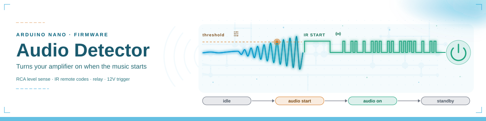
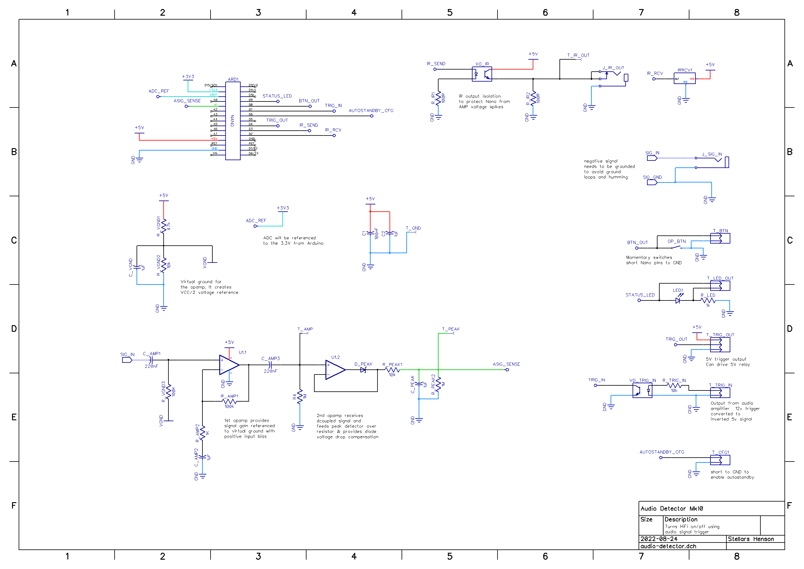
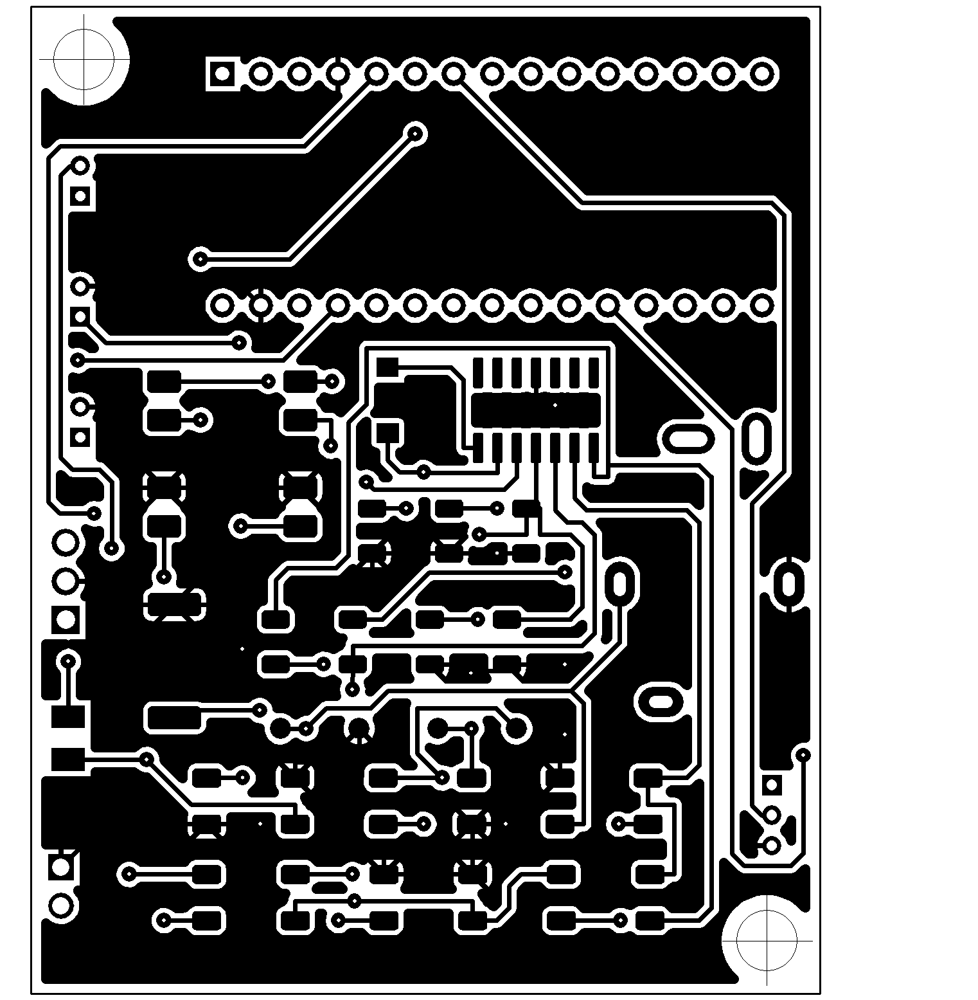
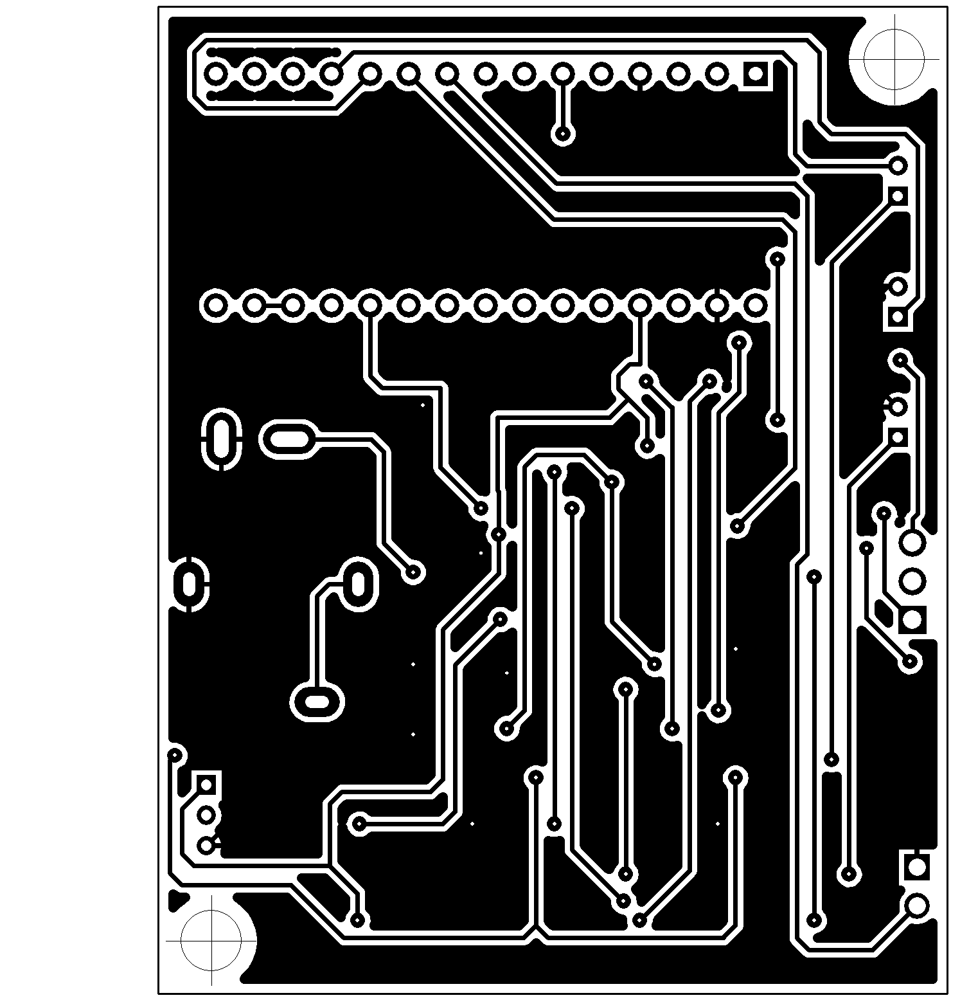
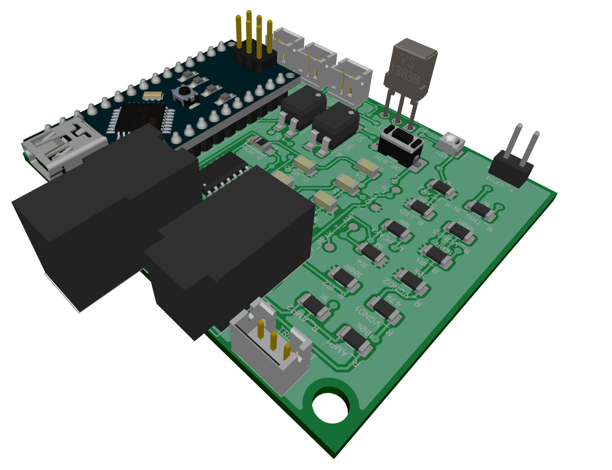
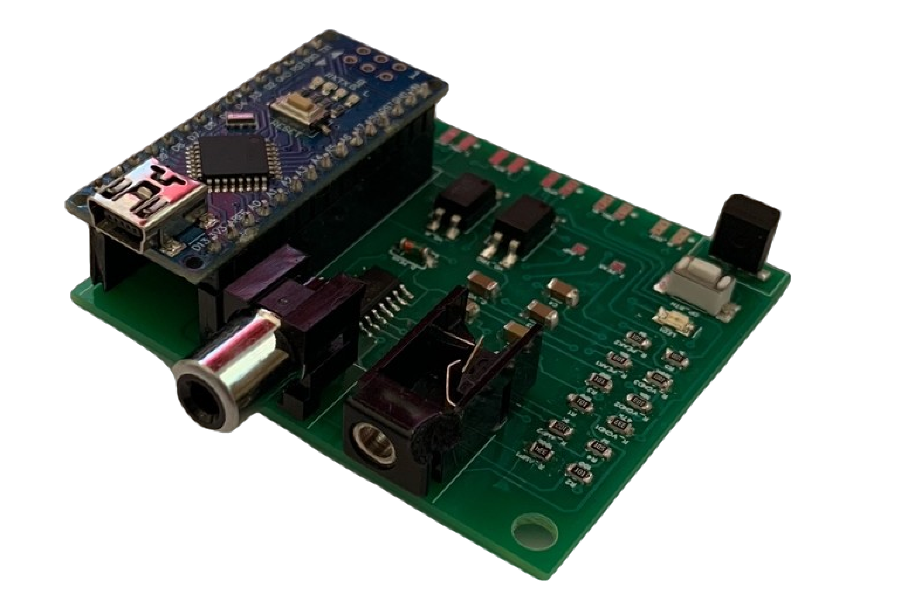

# Audio Trigger / Detector
This device listens for an audio signal at the RCA input and in response turns the audio equipment on using an IR remote code and a relay output. It turns the audio equipment off when the amplifier's 12V trigger goes low, or when no audio signal was detected for longer than 10 minutes.

The firmware runs on an Arduino Nano and is built with PlatformIO: the sketch `src/audio-detector.ino` and the audio level driver `src/AudioLevel.h` and `src/AudioLevel.cpp`. The libraries it uses are bundled in `lib/vendor/`. The PCB design files are in `references/schematics/` and the board images in `resources/graphics/`.


## Initial Setup ##

### Installation ###
* Connect the RCA splitter to the RCA socket of the device
* Connect one end of the 3.5mm jack cable to the device and the other one to the audio amplifier IR input
* Optionally connect the amplifier's 12V trigger output to the trigger connector at the back of the device
* Connect the mini-USB power cable


### Use ###
When powered, the system indicates if any pre-recorded IR codes were found by blinking slowly every 2 seconds.
If not, the fast blinking indicates that you need to set up the device. You need to press and hold the button.

It will initiate 2-stage recording, first the AUDIO START code and then the AUDIO STOP code.
The system indicates the recording status with a LED: fast blinking for the 1st stage and slower blinking for the 2nd.
Only NEC and Sony remote codes can be recorded, because the device can send only those two protocols. A code of any other protocol is rejected with a message on the serial line, and recording keeps waiting. Repeat frames sent while a remote button is held are ignored.

Setting up device sensitivity is done by pressing the device button once while playing audio.
The device listens for 2.5 s and sets the threshold to half the level it heard, but not below 160, so the same music starts the amplifier again (see Audio Level).
Pressing the button while audio is on first turns the audio off, as leaving the audio-on state always does.
Codes and sensitivity are stored in EEPROM and survive a power cycle. A device with an erased EEPROM uses the threshold 300 until a threshold is learned. A threshold below 160 stored by an earlier firmware version is read as 160. A threshold learned by an earlier version is the full playing level (about 579 on loud music), so the same music starts the amplifier late or never: learn the threshold again after flashing this version.

The button has no hardware filter, so the firmware debounces it: a press or release counts after the level stays unchanged for 20 ms. A press shorter than 600 ms starts threshold learning, a longer hold starts IR code recording.

### 12V Trigger and Standby ###
When audio is detected, the device sends the AUDIO START code and sets the audio-enabled output high (relay). It then waits 3 seconds for the amplifier's 12V trigger:
* **12V trigger detected** - the device follows the trigger and returns to listening when the amplifier goes to standby
* **12V trigger not detected** - the device checks the audio signal every minute and returns to listening after 10 minutes of silence

The AUDIO STOP code is sent on leaving the audio-enabled state only when the auto-standby configuration pin (D6) is connected to GND.

### Audio Level ###
The board turns the line-level signal into a slow DC level at A1: a gain stage of 101, a precision rectifier and a peak detector (10 ms attack, 1 s decay). The firmware samples A1 every 51 ms in every state and decides on the average of the last 50 samples (2.5 s). A simulation of the front end and the firmware logic (`notebooks/audio-level-simulation.ipynb`, checked against the firmware on simavr) gives these readings, in ADC counts:
* **quiet** - 4 to 35 with no music: the rectifier's input bias current through its 1 MΩ bias resistor, plus mains hum
* **quiet music** - 20 to 300 for passages between -70 and -45 dBFS (0 dBFS = 2 V RMS)
* **loud music** - 575 to 580 from about -40 dBFS up, where the gain stage saturates

Audio turns on when the average rises above the threshold (default 300, music at about -47 dBFS). Audio on uses a lower off level, a quarter of the threshold (75 by default): quiet music keeps the amplifier on, and it turns off only after 10 minutes in which the average never rose above the off level. After every return to listening the device waits for 50 new samples before it can start the amplifier again, so the music that just stopped and a short spike cannot start it.

### Status Leds ###
* **fast blinking after startup** - device was not configured yet, hold button to record IR codes and press button once to record trigger audio volume
* **slow blinking after startup** - everything is ok, device waits for the audio signal
* **led stays on** - audio detected

* **fast blinking after button hold** - device waits for your first infrared remote signal
* **slower blinking after button hold** - device waits for your second infrared remote signal
* **long blinks after button press** - device learns the volume level for which it should trigger

### Serial Command Line ###
The device accepts commands over USB serial at 9600 baud. A command runs when its line ends with a newline or carriage return; an empty line runs nothing, and characters past 64 in one line are dropped:
* `help` - list the commands
* `status` - print the threshold, off level, current audio level, audio state, auto-standby config, 12V trigger state and debug plot state
* `set threshold <n>` - set the audio sense threshold, 160 to 1023, and save it to EEPROM; other values are ignored
* `set audio [0|1]` - turn the audio off or on
* `set debug_plot [0|1]` - stream each sample, the average, the threshold and the off level to the Arduino Serial Plotter
* `reboot` - restart the device
* `eeprom dump <0-1008>` - print 16 EEPROM bytes as 32 hex characters, prefixed by the address
* `eeprom write <0-1023> <hex>` - write 1 to 16 EEPROM bytes; other addresses or hex strings are ignored


### EEPROM Backup and Restore ###
The firmware keeps the START code in bytes 0-5, the STOP code in bytes 6-11 and the threshold in bytes 12-13. Every revision that stored a threshold uses this layout; the earliest revisions stored only the START code in bytes 0-5, so their bytes 6-13 read as erased. Back up before changing firmware. The upload keeps the EEPROM, so restore only when the EEPROM was lost, and restore before learning the threshold again, because every restore (`.json`, `.bin` or `.hex`) writes bytes 12-13 back. After a restore run `make host-run PORT=<port>`: opening the port resets the board, which then loads the restored codes and threshold, and the JSON line shows them. Run the commands from the project root:
```
make eeprom-backup PORT=/dev/ttyUSB0
make eeprom-restore PORT=/dev/ttyUSB0 FILE=resources/eeprom/eeprom.bin
```
The backup writes three files under `resources/eeprom/`: `eeprom.json` (the START and STOP codes, the threshold and the raw image as hex), `eeprom.bin` (the 1024 raw bytes) and `eeprom.hex` (Intel HEX). Restoring `eeprom.json` writes bytes 0-13 and keeps bytes 14-1023 as they are; restoring `.bin` or `.hex` writes all 1024 bytes. The restore command writes without a prompt, so pass `FILE` deliberately. `make upload` writes flash only and keeps the EEPROM. The `eeprom` commands need this firmware on the board; for a board that runs an earlier firmware, `make eeprom-backup` saves the whole flash image to `resources/eeprom/eeprom.firmware.hex`, flashes the temporary bridge firmware from `scripts/eeprom-bridge`, dumps the EEPROM, then writes the saved image back and verifies it by reading the flash again. A run interrupted while the bridge firmware runs is finished by the next `make eeprom-backup`, which recognises the bridge banner and writes the saved image back. A run interrupted during the flash write-back can leave the board without working firmware; then the next backup stops with `no [HELP] reply`, and `make upload PORT=<port>` flashes the current firmware. The EEPROM and its codes stay, because the backup never writes the EEPROM and the write-back uses `-D`. The tool is the host package `host/src/audiodetector_host/`, run as `python -m audiodetector_host`; it prints one JSON line on success, with the settings and the written paths.

## Arduino ##
The board used is the Arduino Nano and the libraries:
* **arduino-fsm stellarshenson fork** - State Machine was implemented with arduino_fsm state machine library https://github.com/jonblack/arduino-fsm. This project however uses my fork of the library to allow timed transitions reset: https://github.com/stellarshenson/arduino-fsm. Pull was already requested from the *arduino-fsm* owner, hopefully my fork will be merged soon
* **IRRemote v2.6.1** - IR code recording and sending was implemented with library https://github.com/z3t0/Arduino-IRremote
* **JLed v4.5.2** - non-blocking led library used for various blinking patterns
* **EnableInterrupt v1.1.0** - simple interrupt driver
* **Smoothed 1.2.0** - moving average of the last 50 samples (taken 51 ms apart) inside `AudioLevel`; the copy in `lib/vendor/` carries fixes for undefined behaviour in `clear()` and for compiler warnings

### Build ###
The project builds with PlatformIO (`platformio.ini`, environment `nanoatmega328`). In the lab the `firmware-avr` conda environment provides PlatformIO with the matching `atmelavr` platform:
```
make build                          # build
make upload PORT=<serial device>    # build and flash
make monitor PORT=<serial device>   # serial command line at 9600 baud
```
Boards with the new Nano bootloader need `board = nanoatmega328new` in `platformio.ini`.

### Tests ###
The tests run the built `firmware.elf` on simavr, a simulated ATmega328P, and drive the pins the board drives: the audio level on A1, the 12V trigger on D7, the button on D8 with contact bounce, the IR receiver on D2, the auto-standby jumper on D6 and the serial line. They read the relay on D4, the LED on D9, the IR codes sent on D3 and the serial output. `make test` builds the firmware and the simulator wrapper and runs all tests inside the `firmware-avr` conda environment:
```
make build    # firmware only
make test     # firmware, simulator wrapper, unit and functional tests
```
* `test/harness/` - `simharness.c` (C wrapper over libsimavr), `sim.py` (the simulated board), `ir.py` (NEC, Sony and Samsung timings), `eeprom.py` (the EEPROM layout)
* `test/host/` - tests of the IR decoder and the EEPROM layout helper
* `host/tests/` - tests of the EEPROM backup and restore tool in the host package
* `test/functional/` - one or more tests per acceptance criterion, named by its id in the docstring
* `docs/acc-crit-audio-detector.md` and `docs/defects-audio-detector.md` - acceptance criteria and defects, written only through `pm-tools`


## State Machine ##
The system defines 5 states:
* state_audio_sense - the default state, device listens for an audio signal and for the button
* state_ircode_record - active after holding the button, records remote control codes
* state_audio_learn - active after pressing the button once, learns the audio sense threshold
* state_audio_start - active when audio was detected, starts the audio system and waits for the 12V trigger
* state_audio_enabled - active when audio is enabled, waits for standby

| From | To | Trigger |
|---|---|---|
| state_audio_sense | state_ircode_record | TRIGGER_IRCODE_RECORD (button hold) |
| state_ircode_record | state_audio_sense | TRIGGER_IRCODE_RECORDED |
| state_audio_sense | state_audio_learn | TRIGGER_AUDIO_LEARN (button press) |
| state_audio_learn | state_audio_sense | TRIGGER_AUDIO_LEARNED |
| state_audio_sense | state_audio_start | TRIGGER_AUDIO_DETECTED |
| state_audio_start | state_audio_enabled | TRIGGER_AUDIO_ENABLED (12V trigger) or 3s timeout |
| state_audio_enabled | state_audio_sense | TRIGGER_AUDIO_DISABLED (12V trigger low) or 10min timeout |
| state_audio_enabled | state_audio_learn | TRIGGER_AUDIO_LEARN (button press) |
| state_audio_enabled | state_ircode_record | TRIGGER_IRCODE_RECORD (button hold) |


## Circuit and PCB ##
Below are the electronics circuit diagram and the board files (600dpi PNG images) for the PCB fabrication






